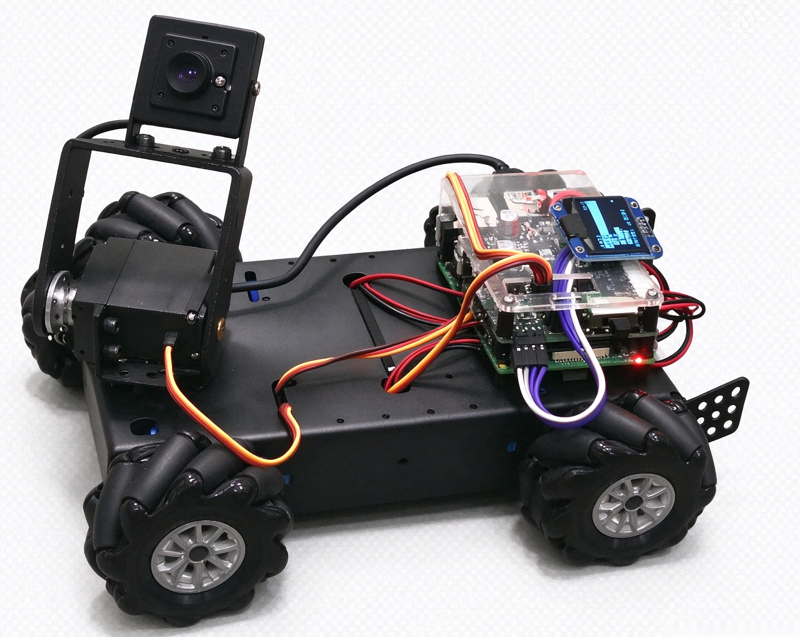

# RovynLab (若问) — 开源教育机器人工坊

[English](./README.md) · [中文](./README.zh-CN.md)

一个硬件与 Python 结合的开源机器人工坊——为教学、折腾、让东西动起来而生。

目前项目：一台带云台摄像头 + LLM 对话的麦轮 AI 小车、一套 OpenCV 视觉工具箱（颜色 / 人脸 / 手势识别）、完整的 Flask 中控面板 + Blockly 积木编程。即将上线：带逆运动学的 6 自由度机械臂。

每个项目都配有循序渐进的教学实验、自包含的代码，零厂商锁定。没有黑盒——机器人做了什么，你就能读到让它做这些的代码，然后改成属于你自己的版本。



---

## 硬件

### 麦轮 AI 小车

| 模块 | 规格 | 接口 |
|------|------|------|
| 主控 | 树莓派 4B 2GB | — |
| 底盘电机 | 4 × TT 直流减速电机 | 自研 L9110S 驱动板 |
| 云台 | 2 × PWM 舵机 | PCA9685 CH0 (水平) / CH1 (垂直) |
| 摄像头 | 720P USB | USB |
| OLED 屏幕 | SH1106 128×64 | I2C @ 0x3C |
| 驱动板（自研） | PCA9685 + L9110S | I2C @ 0x60 |

**PCA9685 通道映射（按实物接线！）：**
```
CH0 → 水平舵机 (Pan)
CH1 → 垂直舵机 (Tilt)
CH1 → 前右电机 (Front Right)
CH2 → 前左电机 (Front Left)
CH3 → 后左电机 (Rear Left)
CH4 → 后右电机 (Rear Right)
I2C 地址 → 0x60
```

---

## 快速开始

```bash
# 1. 启用 I2C
sudo raspi-config nonint do_i2c 0
sudo reboot

# 2. 安装依赖（根目录为 labs/ 和 ai/ 共用，petcar 有独立依赖）
pip3 install -r requirements.txt
pip3 install -r petcar/requirements.txt

# 3. 跑教学实验（自包含，按顺序）
cd labs/
python3 lab01_led_blink.py          # LED 闪烁
python3 lab02_motor_direction.py    # 电机方向
python3 lab06_mecanum_class.py      # 麦轮运动学（Class 版）
python3 lab07_mecanum_global.py     # 麦轮运动学（全局函数版）
python3 lab10_ptz_control.py       # 云台控制
python3 lab12_gesture_hull.py      # OpenCV 凸包手势识别

# 4. 跑综合演示
cd demos/flask_web_control/
python3 app.py                     # 浏览器访问 http://<树莓派IP>:5000

cd demos/object_tracking/
python3 ball_track.py              # 颜色追踪 + 云台 + 底盘

# 5. 跑完整 AI PetCar（推荐）
python3 -m petcar.main --flask --port 5000
# Flask 面板包含视频流、LLM 对话、PID 追踪、Blockly 积木
# 加 --voice 启动完整 ASR/TTS 语音链路
```

---

## 目录结构

```
RovynLab/
├── README.md
├── README.zh-CN.md
├── LICENSE
├── requirements.txt           # labs/ 和 ai/ 共用依赖
├── config.py                  # 硬件常量（I2C 地址 / 速度 / 方向）
│
├── petcar/                    # 🏠 主集成应用
│   ├── main.py                # 入口 (--flask / --voice / --mock)
│   ├── api/                   # Flask 服务 + Blockly 积木编程
│   ├── core/                  # LLM 对话、PID 追踪、情绪引擎、技能
│   ├── drivers/               # 硬件抽象层（麦轮 / 云台 / 摄像头 / OLED / ASR / TTS）
│   ├── blocks/                # Blockly 运行时、编译器、示例程序
│   ├── skills/                # 技能系统（move / ptz / face_detect / express / photo / alarm ...）
│   ├── services/              # whisper systemd 服务
│   ├── docs/                  # 详细设计文档 + UI 截图
│   └── requirements.txt
│
├── labs/                      # 🎓 教学实验（12 节循序渐进）
│   ├── lab01_led_blink.py
│   ├── lab02_motor_direction.py
│   ├── lab03_motor_pwm.py
│   ├── lab04_pwm_servo.py
│   ├── lab05_wheel_test.py
│   ├── lab06_mecanum_class.py     # 面向对象版
│   ├── lab07_mecanum_global.py    # 全局函数版（刻意保留两版）
│   ├── lab08_kinematic.py
│   ├── lab09_joystick.py
│   ├── lab10_ptz_control.py
│   ├── lab11_servo_test.py
│   └── lab12_gesture_hull.py      # OpenCV 凸包手势识别
│
├── demos/                     # 🔧 综合演示项目
│   ├── flask_web_control/      # Vue + Flask Web 控制面板
│   ├── object_tracking/        # 云台 + 底盘 + 颜色追踪
│   ├── traffic_sign/           # SVM 交通标志识别
│   └── tflite_detect/          # TFLite SSD 目标检测
│
├── ai/                        # 👁️ OpenCV 视觉实验
│   ├── ball_track_simple.py
│   ├── face_recognition.py
│   ├── finger.py               # 原版 OpenCV 凸包版
│   └── finger_v2.py            # MediaPipe Hands 版 ★
│
├── aitank_menu/               # 📟 OLED 开机菜单（SH1106 + 5 键）
├── deps/                      # Adafruit_GPIO / MotorHAT / PureIO（已 vendored）
├── core/                      # (预留) 统一驱动层重构
├── docs/                      # 设计文档、课程方案、部署指南
└── tests/                     # petcar 模块回归测试
```

### 设计原则

- **labs/ 必须自包含**。每个 lab 通过路径注入引用 vendored 的 `deps/`——不需要 `pip install adafruit-*`，不依赖 petcar。Clone 下来就能跑。
- **教学梯度是有意设计的**。lab06（Class 版）和 lab07（全局函数版）同时保留——先教函数式入门，再教面向对象进阶。**不要合并**。
- **petcar/ 是产品层**。它把所有东西组合起来（驱动 + LLM + 面板 + 技能 + Blockly），运行在和 labs 同样的硬件之上，是 labs 知识点的集大成。

---

## 路线图

| 状态 | 项目 | 说明 |
|------|------|------|
| ✅ 已完成 | 麦轮 AI 小车 | 云台 + LLM 对话 + PID 追踪 + Blockly |
| ✅ 已完成 | OpenCV 视觉栈 | 颜色 / 人脸 / MediaPipe 手势 / TFLite 目标检测 |
| ✅ 已完成 | Flask 中控面板 | 视频流、7 色识别、PID 调参、对象检测、LLM 对话、Blockly |
| ✅ 已完成 | OLED 开机菜单 | SH1106、5 键导航、WiFi 管理、应用启动器 |
| 🚧 下一个 | 4 自由度机械臂 | 逆运动学 + 舵机控制 + 视觉抓取实验 |
| 🚧 下一个 | IMU 集成 | 6 轴 IMU + 航位推算 + 闭环里程计课程 |

---

## 许可证

自定义非商用许可——免费用于个人学习、教学和研究。商用须提前获得书面授权。完整条款见 [LICENSE](./LICENSE)（中英双语）。
