# PetCar（AITank 小坦）使用说明书

> 适用固件：`petcar` 板载服务（Flask + 积木编程）与 `aitank_menu` 开机菜单
> 面板地址：<http://10.1.1.112:5000/>
> 积木地址：<http://10.1.1.112:5000/blocks>
> 文档版本：v1.1（2026-11-18）
> Web 截图环境：1920 × 1080 全屏浏览器，直接截取自运行中的小车面板
> OLED 截图：由小车上的实际菜单渲染器导出 128 × 64 原始画面，再等比放大并标注

---

## 目录

1. [产品简介](#1-产品简介)
2. [连接与打开面板](#2-连接与打开面板)
3. [界面总览](#3-界面总览)
4. [顶部导航](#4-顶部导航)
5. [实时视频](#5-实时视频)
6. [运动控制](#6-运动控制)
7. [状态与表情](#7-状态与表情)
8. [颜色识别](#8-颜色识别)
9. [PID 云台追踪](#9-pid-云台追踪)
10. [对象识别](#10-对象识别)
11. [对话 / 语音](#11-对话--语音)
12. [日志](#12-日志)
13. [技能调试](#13-技能调试)
14. [面板设置](#14-面板设置)
15. [积木编程](#15-积木编程)
16. [积木文件管理](#16-积木文件管理)
17. [典型使用流程](#17-典型使用流程)
18. [常见问题排查](#18-常见问题排查)
19. [I2C OLED 与开机菜单控制](#19-i2c-oled-与开机菜单控制)
20. [安全与注意事项](#20-安全与注意事项)

---

## 1. 产品简介

PetCar（面板内名称：**AITank · 中控面板**，默认宠物名 **小坦**）是一台可语音交互的轮式机器人小车，主要能力包括：

| 能力 | 说明 |
| --- | --- |
| 实时视频 | 摄像头 MJPEG 视频流，约 15fps，支持拍照 |
| 底盘运动 | 麦轮底盘，支持 8 方向运动、原地转向、定时自动停止 |
| 云台控制 | 二自由度云台（水平 H / 俯仰 V），支持按角度步进与回中 |
| 宠物动作 | 云台 + 底盘组合动作（点头、摇头、转圈、蹭蹭等 12 种） |
| 表情 | OLED 显示 12 种表情，并带情绪状态（愉悦 V / 唤醒 A / 强度 I） |
| 视觉识别 | 人、宠物、水杯、网球、屏幕、运动、颜色、手势、人脸等开关式检测 |
| 颜色识别 | HSV 阈值可调，7 种预设色，可在视频中画框 |
| PID 追踪 | 云台自动追踪人脸 / 颜色积木 / 网球 |
| 语音对话 | LLM 对话（Ollama / 豆包）、ASR 语音识别、TTS 语音合成 |
| 积木编程 | 浏览器内拖拽积木生成 Python，一键在车上运行 |
| 开机菜单 | I2C OLED + USB 键盘，支持应用启动、Wi-Fi 连接、网络状态查看与重启 |

---

## 2. 连接与打开面板

1. 开机前接好 USB 键盘，再给小车通电，等待板载服务启动（通常 20–40 秒，首次加载语音模型可能更久）。
2. 电脑 / 手机连接到**与小车同一局域网**的 Wi-Fi。需要调整小车网络时，使用 OLED 菜单的 `WIFI`；需要查小车 IP 时，使用 `NETWORK`。
3. 如果面板没有自动启动，在 OLED 主菜单选择 `APPS` → `PETCAR FULL`，按 `Enter`，等待语音与面板启动。
4. 浏览器打开 <http://10.1.1.112:5000/>，即可进入中控面板。
5. 需要积木编程时，打开 <http://10.1.1.112:5000/blocks>，或在中控面板点右上角「AITank 积木编程」。
6. 建议按 `F11` 进入全屏，1920 × 1080 分辨率下布局最完整。

> 提示：手机浏览器同样可以访问，只是卡片会按屏宽自动重排。如果开机后 OLED 没有显示菜单，先看[第 19.9 节](#199-开机菜单故障排查)。

---

## 3. 界面总览

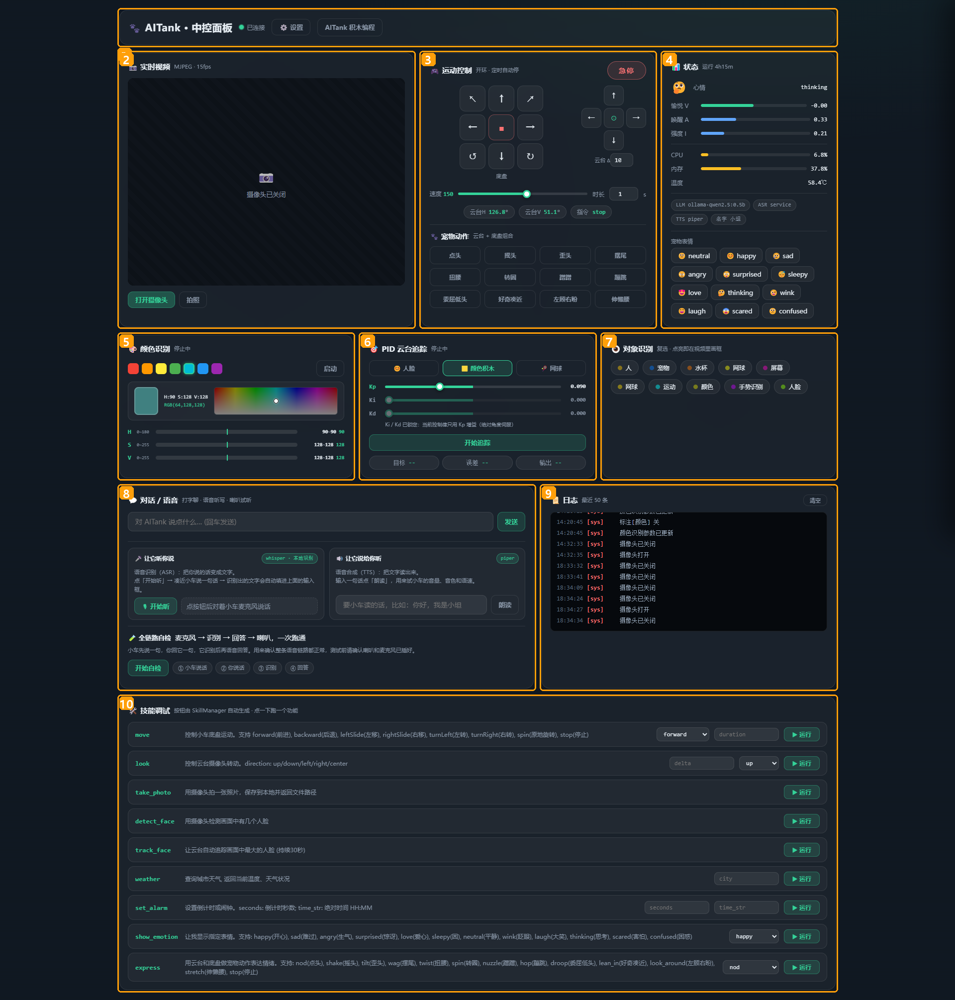

整块中控面板由 10 个区域组成：

| 编号 | 区域 | 作用 |
| --- | --- | --- |
| ① | 顶部导航 | 显示连接状态，进入设置或积木编程 |
| ② | 实时视频 | 摄像头画面、开关摄像头、拍照 |
| ③ | 运动控制 | 底盘方向、云台方向、速度、时长、宠物动作、急停 |
| ④ | 状态 | 心情、情绪三轴、CPU / 内存 / 温度、当前模型与问候 |
| ⑤ | 颜色识别 | HSV 色域调节与颜色检测开关 |
| ⑥ | PID 云台追踪 | 选择追踪目标，调 Kp，启动 / 停止追踪 |
| ⑦ | 对象识别 | 逐个点亮视觉检测器 |
| ⑧ | 对话 / 语音 | 文字对话、语音听写、语音朗读、全链路自检 |
| ⑨ | 日志 | 最近 50 条系统 / 动作 / 对话日志 |
| ⑩ | 技能调试 | 单独调用某个技能并填入参数 |

> 图例：**红色框 + 数字** = 可点击的按钮；**橙色框** = 区域 / 面板；**绿色框** = 状态指示。

---

## 4. 顶部导航

| 编号 | 元素 | 说明 |
| --- | --- | --- |
| 绿框 | 连接状态 | 绿点 + 「已连接」表示面板已与小车服务连通；变红或显示断开时先刷新页面 |
| ① | ⚙️ 设置 | 打开右侧「面板设置」抽屉，修改宠物名、人设、LLM、语音等参数 |
| ② | AITank 积木编程 | 跳转到积木编程页（等价于访问 `/blocks`） |

---

## 5. 实时视频

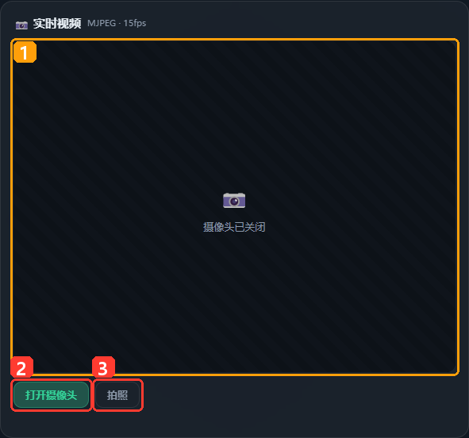

| 编号 | 元素 | 说明 |
| --- | --- | --- |
| ① | 视频画面 | 摄像头 MJPEG 实时画面；对象识别、颜色识别会在画面上叠加彩色检测框 |
| ② | 打开摄像头 / 关闭摄像头 | 切换摄像头。关闭后画面显示「摄像头已关闭」，再次点击即可恢复 |
| ③ | 拍照 | 立即拍一张照片，成功后照片缩略图出现在按钮下方，文件保存在小车本地 |

使用要点：

- 首次进入若显示「摄像头已关闭」，先点②打开摄像头。
- **画面全黑**通常不是故障：请开灯、移开遮挡物，或点②关闭再打开一次以重连视频流。
- 画面下方的小字 `MJPEG · 15fps` 表示当前为视频流模式；断流时画面会提示「视频流中断, 重连中…」并自动重试。
- 拍照得到的照片可在照片目录查看，也可让 AI 通过 `take_photo` 技能拍摄。

---

## 6. 运动控制

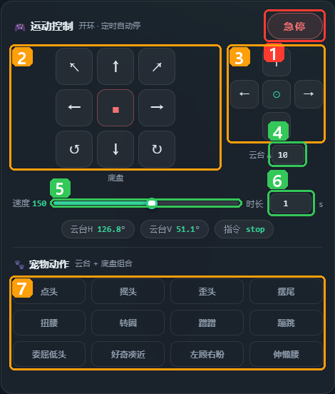

| 编号 | 元素 | 说明 |
| --- | --- | --- |
| ① | 急停 | 立即停止底盘与云台动作，并中断正在执行的动作，异常时第一时间点它 |
| ② | 底盘方向键 | 9 键麦轮控制：`↖ ↑ ↗ / ← ■ → / ↺ ↓ ↻`，中间 ■ 为停止；`↺ ↻` 为原地左 / 右转 |
| ③ | 云台方向键 | `↑ ↓ ← →` 步进转动云台，中间 `⊙` 为**回中** |
| ④ | Δ 角度 | 云台每点一次转动的角度，默认 10°，可改 1–45° |
| ⑤ | 速度滑块 | 底盘速度 PWM，范围 30–255，默认 150；数值越大越快 |
| ⑥ | 时长 | 每次方向指令的持续时间（0.2–10 秒），到点自动停止，避免撞墙 |
| ⑦ | 宠物动作 | 12 个组合动作：点头、摇头、歪头、摆尾、扭腰、转圈、蹭蹭、蹦跳、委屈低头、好奇凑近、左顾右盼、伸懒腰 |

操作建议：

1. 先在⑥把时长设为 1 秒左右，低速试方向。
2. 确认方向正确后再加大⑤速度。
3. 云台乱转时点③中间的 `⊙` 回中。
4. 任何异常直接点①急停。

---

## 7. 状态与表情

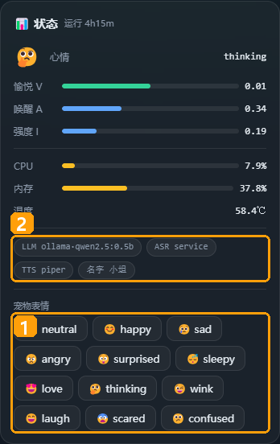

| 编号 | 元素 | 说明 |
| --- | --- | --- |
| ① | 宠物表情 | 12 个表情按钮，点击后 OLED 立即切换对应表情（neutral / happy / sad / angry / surprised / sleepy / love / thinking / wink / laugh / scared / confused） |
| ② | 配置概览 | 只读信息：当前 LLM 后端与模型、ASR 服务、TTS 引擎、宠物名字 |

状态区上半部分为实时数据：

- **心情**：当前情绪标签（如 happy、thinking、sleepy）。
- **愉悦 V / 唤醒 A / 强度 I**：情绪三轴，范围 -1 ~ 1，随对话与动作变化。
- **CPU / 内存 / 温度**：小车系统负载，温度持续偏高时注意散热。

---

## 8. 颜色识别

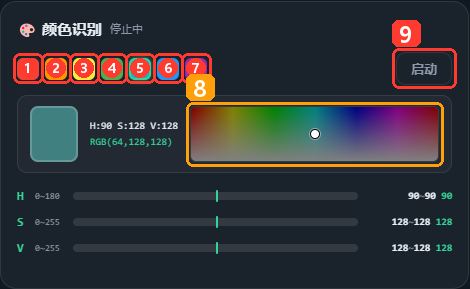

| 编号 | 元素 | 说明 |
| --- | --- | --- |
| ①–⑦ | 色板 | 红、橙、黄、绿、青、蓝、紫 7 个预设，点一下即套用该颜色的 HSV 范围 |
| ⑧ | HSV 预览 | 左侧色块为目标色，右侧为当前 H/S/V 阈值下的取色示意 |
| ⑨ | 启动 / 停止 | 开启或关闭颜色检测；开启后视频画面会给命中的色块画框 |

使用步骤：

1. 把色块（积木、球、卡片）放到镜头前。
2. 点①–⑦中与实际颜色最接近的预设。
3. 若识别不准，拖动画布下方的 `H / S / V` 三个滑块微调：H 控制色相，S 控制饱和度，V 控制亮度。
4. 点⑨启动，观察视频画面中的检测框是否稳定。

> 识别结果也会供 PID 追踪与积木「颜色识别」积木使用。

---

## 9. PID 云台追踪

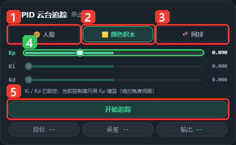

| 编号 | 元素 | 说明 |
| --- | --- | --- |
| ① | 人脸 | 追踪画面中最大的人脸 |
| ② | 颜色积木 | 追踪当前 HSV 阈值命中的颜色块（与颜色识别共享参数） |
| ③ | 网球 | 追踪网球 |
| ④ | Kp 滑块 | 比例增益，默认 0.9；越大反应越快，过大会左右抖动 |
| ⑤ | 开始追踪 / 停止追踪 | 启动或停止云台自动追踪 |

说明：

- 当前版本只启用 **Kp**，`Ki / Kd` 为锁定状态（界面提示「当前控制器只用 Kp 增益」）。
- 下方「目标 / 误差 / 输出」三块用于观察追踪状态：目标出现后误差会变为实际像素偏差，输出为云台控制量。
- 追踪前请确认目标在画面中，且④不要调得过大。
- 需要让小车边追边动时，请使用积木页的「追踪」积木组合。

---

## 10. 对象识别

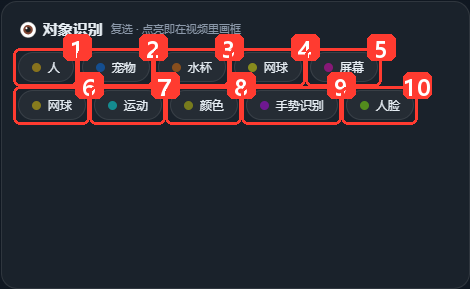

点亮即开启，再点一次关闭；开启的检测器会在视频画面中绘制对应颜色的框。

| 编号 | 检测器 | 说明 |
| --- | --- | --- |
| ① | 人 | 人体目标检测 |
| ② | 宠物 | 猫狗等宠物检测 |
| ③ | 水杯 | 杯子检测 |
| ④ | 网球 | 通用球类目标检测 |
| ⑤ | 屏幕 | 显示器 / 电视 / 手机屏幕检测 |
| ⑥ | 网球 | 网球**颜色**追踪（与颜色识别参数联动） |
| ⑦ | 运动 | 画面运动区域检测 |
| ⑧ | 颜色 | 颜色阈值检测（等同颜色识别开关） |
| ⑨ | 手势识别 | 手势检测 |
| ⑩ | 人脸 | 人脸检测（PID 追踪人脸也依赖它） |

建议一次只开 1–3 个检测器，开太多会明显增加 CPU 占用、降低帧率。

---

## 11. 对话 / 语音

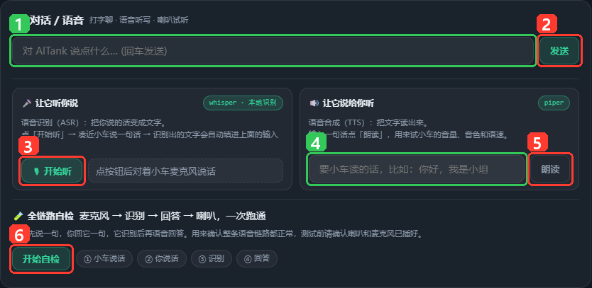

| 编号 | 元素 | 说明 |
| --- | --- | --- |
| ① | 对话输入框 | 输入文字，按回车或点②发送给 AI |
| ② | 发送 | 提交对话；回复会显示在输入框下方，并可能附带表情与动作 |
| ③ | 🎙 开始听 | 录一句话做语音识别，识别文字自动填入① |
| ④ | 朗读文本框 | 输入要小车读出来的话 |
| ⑤ | 朗读 | 用当前 TTS 音色朗读④中的文字，用于试音量、音色、语速 |
| ⑥ | 开始自检 | 跑「小车说话 → 你说话 → 识别 → 回答」全链路，验证麦克风与喇叭 |

使用要点：

- 两个小徽章显示 ASR / TTS 的检测结果（`service`、`piper` 等），显示异常时先看[面板设置](#14-面板设置)。
- 语音识别时尽量靠近小车、环境安静；识别失败会在下方给出提示。
- AI 回复除了文字，还可能触发表情、动作、拍照、查询天气等技能。
- 全链路自检会外放声音，注意音量。

---

## 12. 日志

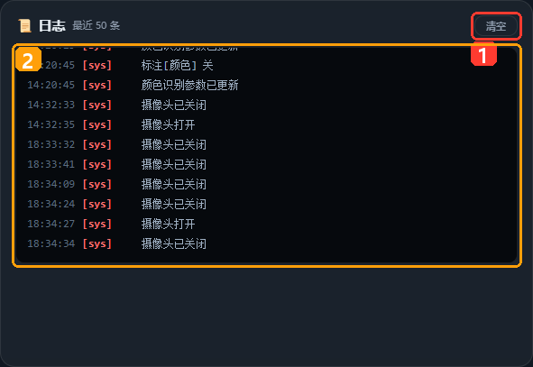

| 编号 | 元素 | 说明 |
| --- | --- | --- |
| ① | 清空 | 清空当前面板上的日志显示（不影响小车本地日志文件） |
| ② | 日志控制台 | 最近 50 条记录，按时间倒序排列，`[sys]` 系统、`[chat]` 对话、`[action]` 动作、`[photo]` 拍照、`[detect]` 检测、`[skill]` 技能 |

排查问题时的顺序：先看日志有没有红色/异常记录 → 再看[状态](#7-状态与表情)里的 CPU、温度 → 最后检查[面板设置](#14-面板设置)里的模型与语音配置。

---

## 13. 技能调试

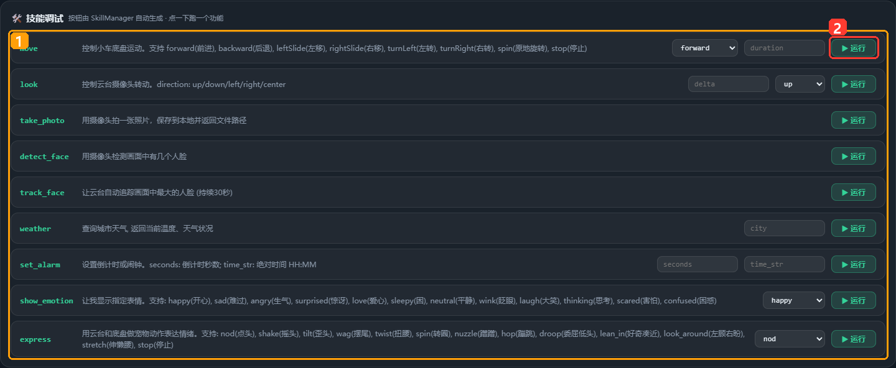

| 编号 | 元素 | 说明 |
| --- | --- | --- |
| ① | 技能列表 | 每个技能显示名称、说明与参数说明（参数来自技能定义） |
| ② | 运行 | 用当前填写的参数单独执行该技能，结果直接显示在行内 |

内置技能：

| 技能 | 作用 | 主要参数 |
| --- | --- | --- |
| `move` | 底盘运动 | direction（forward/backward/leftSlide/rightSlide/turnLeft/turnRight/spin/stop）、duration |
| `look` | 云台转动 | direction（up/down/left/right/center）、delta |
| `take_photo` | 拍照 | 无 |
| `detect_face` | 统计人脸数量 | 无 |
| `track_face` | 云台追踪最大人脸 30 秒 | 无 |
| `weather` | 查询城市天气 | city（默认北京） |
| `set_alarm` | 倒计时 / 闹钟 | seconds 或 time_str（HH:MM） |
| `show_emotion` | 显示表情 | emotion（12 种） |
| `express` | 组合宠物动作 | action（含 stop） |

技能调试适合验证单个能力；多步骤流程请使用[积木编程](#15-积木编程)。

---

## 14. 面板设置

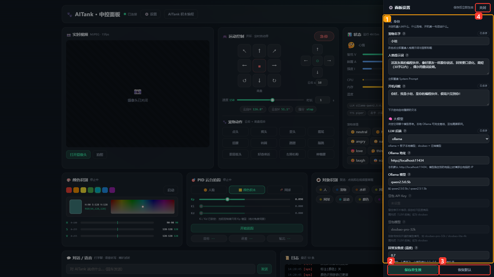

点顶部「⚙️ 设置」打开右侧抽屉。

| 编号 | 元素 | 说明 |
| --- | --- | --- |
| ① | 设置项 | 按分组显示：宠物人设、LLM、语音合成、ASR 等；直接修改输入框 / 下拉框 |
| ② | 保存并生效 | 提交所有修改；多数配置立即生效，个别字段会提示需要重启服务 |
| ③ | 恢复默认 | 把当前所有设置恢复为默认值（仍需点②保存） |
| ④ | 关闭 | 关闭抽屉，不保存修改 |

常用设置说明：

- **宠物名字 / 主人昵称**：影响 AI 自称与称呼，例如「小坦」「主人」。
- **人设提示词 / 系统提示词 / 开场白**：决定说话风格与首次问候语。
- **上下文窗口 / 记忆条数**：越大越能记住前文，但更占内存与推理时间。
- **LLM 后端**：`ollama`（本地）或 `豆包`（云端，需要 API Key）。
- **Ollama 地址 / 模型**：本地大模型服务地址与模型名，例如 `qwen2.5:0.5b`。
- **语音合成音色**：`piper` 本地音色或云端音色，可先用「朗读」试听。
- **ASR 服务**：`service` 表示使用板载语音识别服务。

> 修改后如果对话无响应，先确认 Ollama 服务是否在运行、模型是否已下载；云端后端请检查 API Key 与网络。

---

## 15. 积木编程

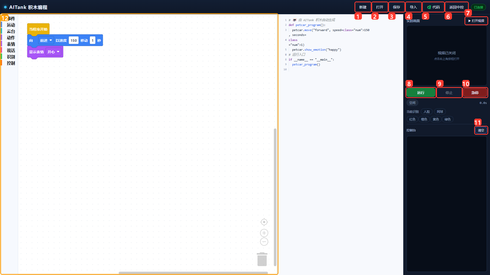

左侧为分类工具箱与积木画布，中间是自动生成的 Python 代码，右侧是运行控制、实时画面和识别状态。

| 编号 | 元素 | 说明 |
| --- | --- | --- |
| ① | 新建 | 清空画布，从空白开始搭积木 |
| ② | 打开 | 打开文件管理弹窗，载入板上示例或「我的积木」 |
| ③ | 保存 | 保存当前积木到小车用户目录 |
| ④ | 导入 | 从本地电脑导入 `.json` 积木文件 |
| ⑤ | 🐍 代码 | 显示 / 隐藏中间的 Python 代码预览 |
| ⑥ | 返回中控 | 回到中控面板 |
| ⑦ | 打开视频 / 关闭视频 | 开关右上角实时画面（关闭可省带宽与 CPU） |
| ⑧ | 运行 | 把积木转换成 Python 并在小车上执行 |
| ⑨ | 停止 | 停止当前程序，保留云台与底盘最后状态 |
| ⑩ | 急停 | 立即中断程序并停止所有动作，异常时优先点它 |
| ⑪ | 清空 | 清空下方控制台输出 |
| ⑫ | 积木工作区 | 拖拽积木的区域；左侧分类：事件、运动、云台、表情、说话、识别、控制 |

使用步骤：

1. 从左侧拖出「事件」积木作为程序入口（如「当程序启动」）。
2. 按顺序拼接运动、云台、表情、说话、识别类积木。
3. 观察中间代码预览，确认逻辑（代码由积木实时生成）。
4. 点③保存并命名，再点⑧运行。
5. 运行时看右侧「状态 / 当前识别 / 控制台」，出现异常点⑨或⑩。

> 注意：运行前请确认小车周围留有空间；急停后程序不会自动续跑，需要重新点⑧。

---

## 16. 积木文件管理

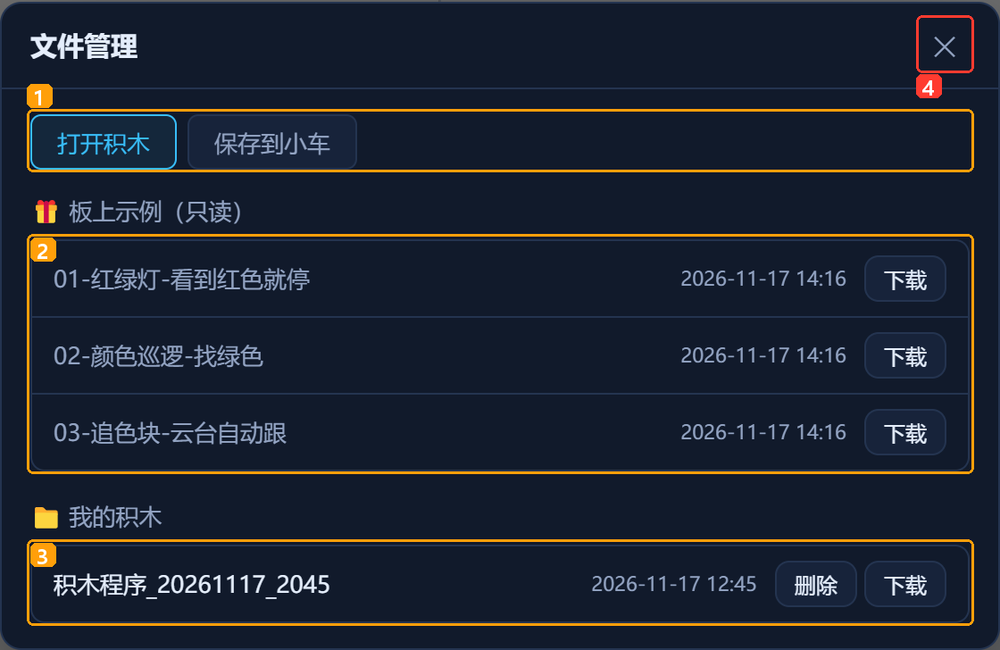

点积木页的「打开」或「保存」会弹出文件管理窗。

| 编号 | 元素 | 说明 |
| --- | --- | --- |
| ① | 页签 | 「打开积木」与「保存到小车」两个页签 |
| ② | 板上示例（只读） | 随车附带的示例程序，只能打开不能覆盖 |
| ③ | 我的积木 | 自己保存的积木文件，可打开、覆盖保存 |
| ④ | 关闭 | 关闭弹窗 |

保存流程：

1. 切到「保存到小车」页签。
2. 输入文件名（默认按时间生成）。
3. 点「确认保存」，文件写入小车的 `~/.aitank/blocks/user/` 目录。
4. 同名文件会被覆盖，重要版本建议改名另存。

---

## 17. 典型使用流程

### 17.1 遥控小车走一圈

1. 顶部确认「已连接」。
2. 实时视频点「打开摄像头」。
3. 运动控制：时长设 1s、速度 150，点 `↑` 试走。
4. 方向确认后，用 `← / → / ↺ / ↻` 绕障；异常点「急停」。

### 17.2 和小车聊天

1. 在对话输入框输入「你好呀」，回车。
2. 小车文字回复并可能摆动作、换表情。
3. 想听声音就点「朗读」，或在设置里调好音色。
4. 语音交互时点「🎙 开始听」，靠近小车说话；不放心就先跑一次「开始自检」。

### 17.3 让云台追着人转

1. 对象识别里点亮「人脸」。
2. PID 云台追踪选「人脸」，Kp 先保持 0.9。
3. 点「开始追踪」，在你面前左右移动，观察云台跟随。
4. 画面开始来回抖就把 Kp 调小；结束时点「停止追踪」。

### 17.4 用积木做一个「看到红色就停下」的小车

1. 进入积木编程，拖出「当程序启动」。
2. 拼上「重复执行」→「前进」→「如果 看到颜色（红）」→「停止」。
3. 保存为 `看到红色就停`，点「运行」。
4. 用红色卡片在镜头前晃动，验证小车是否停下。

---

## 18. 常见问题排查

| 现象 | 可能原因 | 处理方法 |
| --- | --- | --- |
| 页面打不开 | 不在同一网络、IP 变了、服务未启动 | 确认电脑与小车同网段；`ping 10.1.1.112`；重启小车服务 |
| 右上角显示断开 / 红点 | 服务中断、网络抖动 | 刷新页面；检查小车电源与日志 |
| 视频全黑 | 环境太暗、镜头被挡、视频流卡住 | 开灯、移开遮挡；点「关闭摄像头」再「打开摄像头」 |
| 视频提示「重连中」 | MJPEG 连接断开 | 等待自动重连；仍失败则刷新页面 |
| 拍照无缩略图 | 存储空间不足 / 摄像头未打开 | 先打开摄像头；清理小车磁盘 |
| 方向不对 | 麦轮接线或安装方向 | 低速测试，必要时在设置中校正方向 |
| 云台不动 / 一直转 | 超出限位、PID 抖动 | 点回中；降低 Kp；检查云台是否卡住 |
| 颜色识别不准 | 光照变化、阈值不合适 | 换预设或调 H/S/V；避免强反光 |
| 语音识别无结果 | 麦克风未插好、环境嘈杂 | 靠近说话；跑「开始自检」；检查 ASR 徽章 |
| AI 不回复 | Ollama 未启动、模型未下载、API Key 错误 | 检查设置中的后端、地址、模型；看日志报错 |
| 积木运行没反应 | 没保存、程序已停止、积木未连到事件 | 保存后点运行；检查事件积木；看控制台日志 |
| 点运行后小车乱跑 | 速度 / 时长设置过大 | 先点「急停」，把速度与时长调小 |
| 开机后面板打不开 | PetCar 未自动启动或语音模型仍在加载 | 在 OLED 选择 `APPS` → `PETCAR FULL`；再查 `NETWORK` 中的实际 IP |
| OLED 无显示 / 键盘无反应 | 菜单服务未运行、键盘后插或 OLED 正被 PetCar 独占 | 先确认 PetCar 是否正在显示表情；否则接好键盘并重启 `aitank-menu` |
| Wi-Fi 列表中的 `1X` 网络连不上 | 802.1X 需要账号与证书，菜单只支持单次密码输入 | 改用 WPA / 开放网络，或由管理员配置企业网络 |

---

## 19. I2C OLED 与开机菜单控制

### 19.1 屏幕、键盘与图例

小车开机菜单使用 **128 × 64 单色 I2C OLED**（默认地址 `0x3C`，兼容 SH1106 / SSD1306）和 **USB 键盘**。建议开机前接好键盘。

- **顶部状态栏**：Wi-Fi 图标、当前 SSID、有线网口图标和时间；未连接 Wi-Fi 时显示 `no wifi`。
- **中间主区域**：最多显示 4 行；反白行是当前选中项，`^ / v` 表示还能向上 / 向下滚动。
- **底部提示栏**：显示当前页面可用的按键。
- 本章图片由板上实际菜单渲染器导出；`images/oled/raw/` 保存原始 128 × 64 PNG。说明书使用 3 倍最近邻放大图（128 × 64 → 384 × 192），左侧编号已按可读性单独放大，**图下方的键盘按键示意不属于 OLED 显示内容**。

标注规则：**绿框 ①** = 状态栏；**红框** = 当前选中项或输入区；**橙框** = 内容 / 按键提示。各图下方红框是 USB 键盘操作示意，橙框 `PLEASE WAIT` 表示等待。

| 按键 | 通用作用 |
| --- | --- |
| `↑` / `↓` | 移动选中项、切换选项或滚动网络详情 |
| `Enter` / `→` | 确认、进入、连接或刷新；密码页只用 `Enter` 连接 |
| `←` / `Esc` | 返回上一级或取消；**在主菜单会直接退出菜单** |
| 字母、数字、符号键 | 在 Wi-Fi 密码页输入 ASCII 字符；`Shift` 可输入大写和 shifted 符号 |
| `Backspace` | 删除密码末尾一个字符 |

### 19.2 主菜单：APPS / WIFI / NETWORK / REBOOT / EXIT

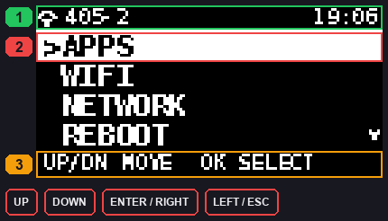

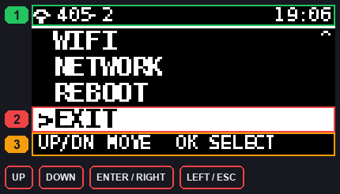

| 编号 | 区域 | 操作 |
| --- | --- | --- |
| ① | 状态栏 | 查看 Wi-Fi、SSID、有线连接与时间 |
| ② | 当前选中项 | 用 `↑ / ↓` 移动，用 `Enter / →` 进入 |
| ③ | 按键提示 | `UP/DN MOVE` = 移动；`OK SELECT` = 确认 |

| 菜单项 | 功能 |
| --- | --- |
| `APPS` | 进入应用列表，启动 `PETCAR FULL` |
| `WIFI` | 扫描并连接 Wi-Fi |
| `NETWORK` | 查看 IP、MAC、网关、DNS 和运行时间 |
| `REBOOT` | 进入整机重启确认页 |
| `EXIT` | 退出并停止开机菜单，释放 OLED 与键盘；不会启动 PetCar，也不会关机 |

主菜单只有 4 个可见行，移到第 5 项 `EXIT` 时列表会自动向上滚动。主菜单按 `← / Esc` 与选择 `EXIT` 等效；误退后可重启 `aitank-menu` 服务或重启整机恢复。

### 19.3 APPS：启动 PetCar 完整功能

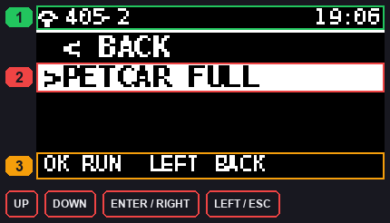

| 编号 | 区域 | 操作 |
| --- | --- | --- |
| ② | `< BACK` / `PETCAR FULL` | 选择 `< BACK` 返回；选择 `PETCAR FULL` 启动完整语音与 Web 面板 |
| ③ | 按键提示 | `OK RUN` = 启动；`LEFT BACK` = 返回 |

启动步骤：

1. 在主菜单选中 `APPS`，按 `Enter`。
2. 选中 `PETCAR FULL`，按 `Enter / →`。
3. 出现下面的 `Launching...` 后不要连续按键，等待服务启动。

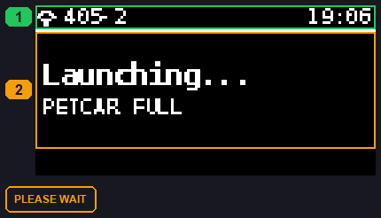

| 编号 | 区域 | 说明 |
| --- | --- | --- |
| ② | 启动过渡信息 | 正在启动 `PETCAR FULL`，此阶段无需操作 |

启动后菜单进程会退出，PetCar 接管 OLED 并显示宠物表情；随后打开 <http://10.1.1.112:5000/>。菜单服务此时显示为停止是正常现象，不是崩溃。

### 19.4 WIFI：扫描与选择网络

进入 `WIFI` 后先显示扫描提示，通常需要 2–5 秒，期间不要重复按键。

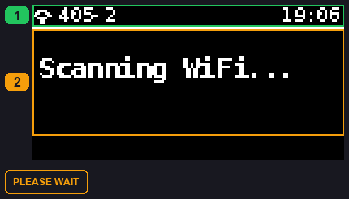

扫描完成后显示实际网络列表：

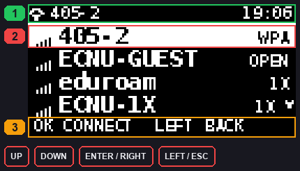

| 编号 | 区域 | 说明 |
| --- | --- | --- |
| ② | 当前 Wi-Fi | 左侧为信号强度，中间为 SSID，右侧为安全类型；用 `↑ / ↓` 选择 |
| ③ | 按键提示 | `Enter / →` 连接；`← / Esc` 返回主菜单 |

安全标签含义：

| 标签 | 含义与下一步 |
| --- | --- |
| `WPA` | 密码网络，进入密码输入页 |
| `OPEN` | 开放网络，跳过密码页并直接连接 |
| `1X` | 802.1X / EAP 企业网络，需要账号和证书，当前菜单不支持 |

同名 SSID 会去重并优先显示已连接项，其余通常按信号强度排列；隐藏 SSID 不在列表中显示。列表超过 4 行时用 `↑ / ↓` 滚动。

### 19.5 输入 Wi-Fi 密码与等待连接

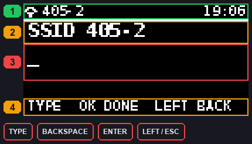

| 编号 | 区域 | 操作 |
| --- | --- | --- |
| ② | SSID | 核对要连接的网络名称 |
| ③ | 密码输入区 | 直接输入密码，`Backspace` 删除；末尾 `_` 是输入光标 |
| ④ | 按键提示 | `Enter` 开始连接；`← / Esc` 不连接并返回列表 |

注意：

- 当前版本**明文显示密码**，最多 64 个 ASCII 字符；输入时避免旁人围观或拍摄。
- 密码页的 `↑ / ↓ / →` 不执行操作；不要用小键盘的方向键代替 `Enter`。
- 切换网络可能暂时断开当前 Wi-Fi 和 Web 面板；连接成功后应在 `NETWORK` 中重新确认 IP。

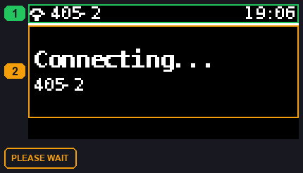

| 编号 | 区域 | 说明 |
| --- | --- | --- |
| ② | 连接状态 | `Connecting...` 下方显示目标 SSID；连接过程中按键被忽略 |

连接结果会短暂显示：成功通常返回主菜单，失败返回 Wi-Fi 列表。失败时先核对密码与信号，再确认不是 `1X` 企业网络。

### 19.6 NETWORK：查看实际 IP 与网络详情

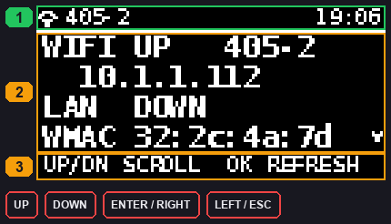

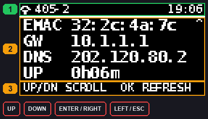

| 编号 | 区域 | 操作 |
| --- | --- | --- |
| ② | 网络详情 | 用 `↑ / ↓` 滚动查看更多行 |
| ③ | 按键提示 | `Enter / →` 刷新并回到首屏；`← / Esc` 返回主菜单 |

常见字段：

| 字段 | 含义 |
| --- | --- |
| `WIFI UP/DOWN` | Wi-Fi 状态与 SSID；下一行显示无线 IP |
| `LAN UP/DOWN` | 有线网络状态；连接时显示有线 IP |
| `WMAC / EMAC` | 无线 / 有线网卡 MAC 地址尾部 |
| `GW` | 默认网关 |
| `DNS` | DNS 服务器 |
| `UP` | 系统连续运行时间 |

截图中的无线地址是 `10.1.1.112`，因此面板地址为 `http://10.1.1.112:5000/`。换网络后不要继续沿用旧 IP，应以本页实际地址为准。

### 19.7 REBOOT：从菜单重启整机

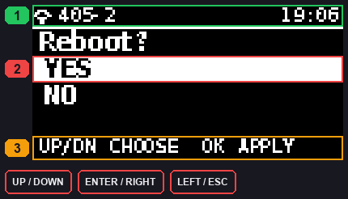

| 编号 | 区域 | 操作 |
| --- | --- | --- |
| ② | `YES / NO` | 默认选中 `YES`；用 `↑ / ↓` 切换 |
| ③ | 按键提示 | `Enter / →` 执行当前选择；`← / Esc` 取消并返回 |

1. 确认已保存积木和设置，并停止运动、识别与积木程序。
2. 若只是查看菜单，按 `← / Esc` 取消；若确实要重启，选择 `YES` 后按 `Enter`。
3. 重启后面板会断开，等待系统与 PetCar 恢复再访问。

> `REBOOT` 依赖菜单进程具备系统重启权限。如果选择 `YES` 后设备没有重启，请由管理员检查 `aitank-menu` 的 `sudo reboot` 权限，不要反复按键。

### 19.8 OLED 与 PetCar 表情的切换

开机菜单和 PetCar 不能同时占用 OLED：

- 菜单阶段显示本章的文本界面。
- 启动 `PETCAR FULL` 后，菜单释放 OLED，PetCar 显示第 7 章介绍的表情。
- 不要同时手动运行第二个 `aitank_menu.main` 或 OLED 测试程序，否则可能出现花屏、闪烁或 I2C 冲突。
- 需要从 PetCar 返回菜单时，先正常停止 PetCar，再启动 `aitank-menu`；或直接重启整机。

### 19.9 开机菜单故障排查

| 现象 | 处理方法 |
| --- | --- |
| OLED 全黑 | 检查 PetCar 是否已接管并显示表情；确认 I2C 接线与 `0x3C` 地址；再检查 `aitank-menu` 状态 |
| 菜单有画面但键盘无效 | 使用 USB 键盘并在开机前接好；重新启动菜单服务；不要只接鼠标 |
| Wi-Fi 列表为空 | 靠近路由器后重新进入 `WIFI`；检查无线网卡和 NetworkManager |
| 输完密码仍失败 | 核对大小写和符号，确认不是 `1X`，靠近路由器后重试 |
| 连接后电脑打不开面板 | 在 `NETWORK` 查新 IP；重新启动 `PETCAR FULL`；电脑也切换到同一网络 |
| 选择重启无效 | 检查菜单服务的 sudo 重启权限；必要时由管理员通过 SSH 重启 |
| 需要查看服务状态 | 使用 `sudo systemctl status aitank-menu`、`sudo systemctl status aitank-whisper` 和 `bash ~/AITank/petcar/start.sh status` |

---

## 20. 安全与注意事项

1. **先急停再处理**：任何失控、异响、卡住，第一时间点「急停」。
2. **低俗试车**：首次运行把速度降到 100 左右、时长 1 秒，确认方向后再加速。
3. **留出空间**：运行积木或追踪时，小车周围至少留 1 米空地，远离桌边与台阶。
4. **云台限位**：不要用手硬掰云台；需要复位时用「回中」。
5. **散热**：状态区温度长时间高于 75℃ 时，停止连续推理 / 检测，让小车休息。
6. **用电安全**：使用配套电源，电量低时及时充电，避免行驶中突然断电。
7. **隐私**：拍照与视频会保存在小车本地，请勿拍摄他人隐私画面并外传。
8. **修改设置前记录原值**：LLM 地址、API Key 等修改后出问题，可用「恢复默认」回退。

---

*本说明书 Web 截图来自运行中的 PetCar 面板（<http://10.1.1.112:5000/>）；OLED 图像来自小车当前部署的开机菜单渲染器，并非相机拍摄。按钮、SSID 与菜单位置可能随版本和网络环境变化，以实际界面为准。*
